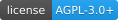
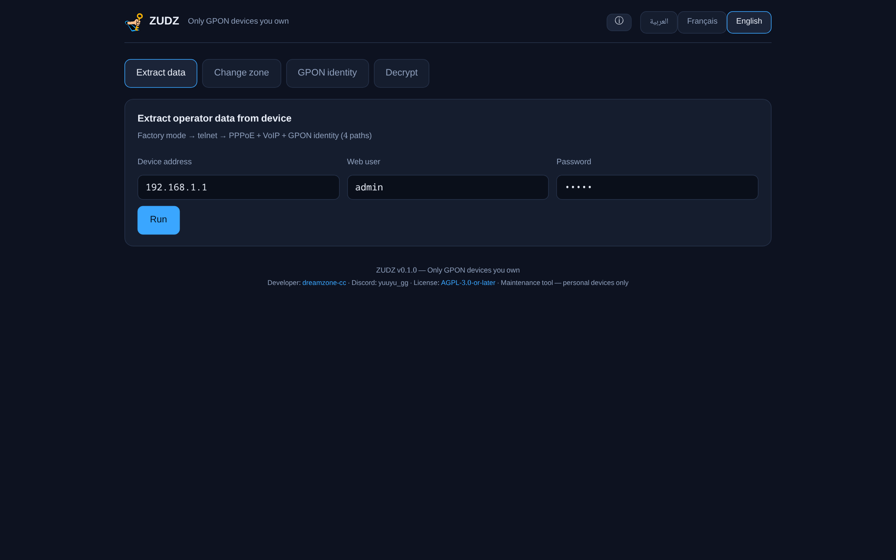
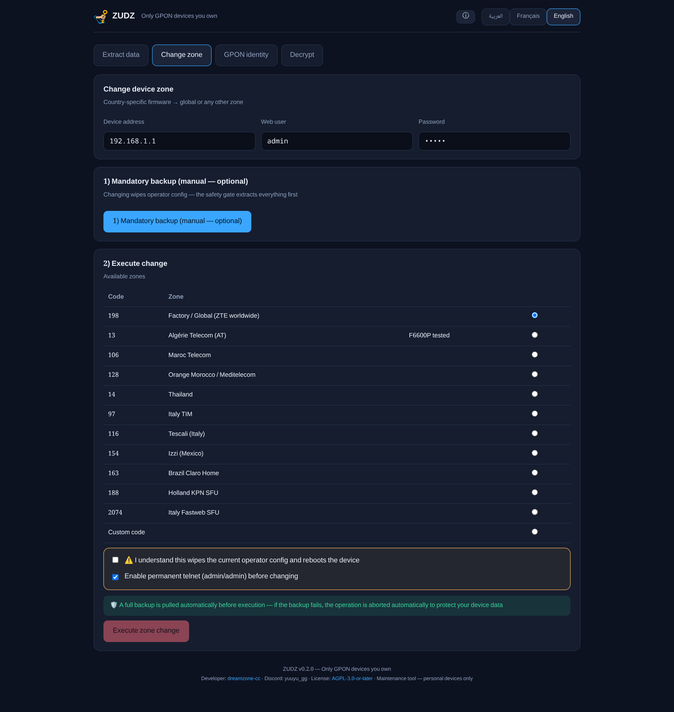
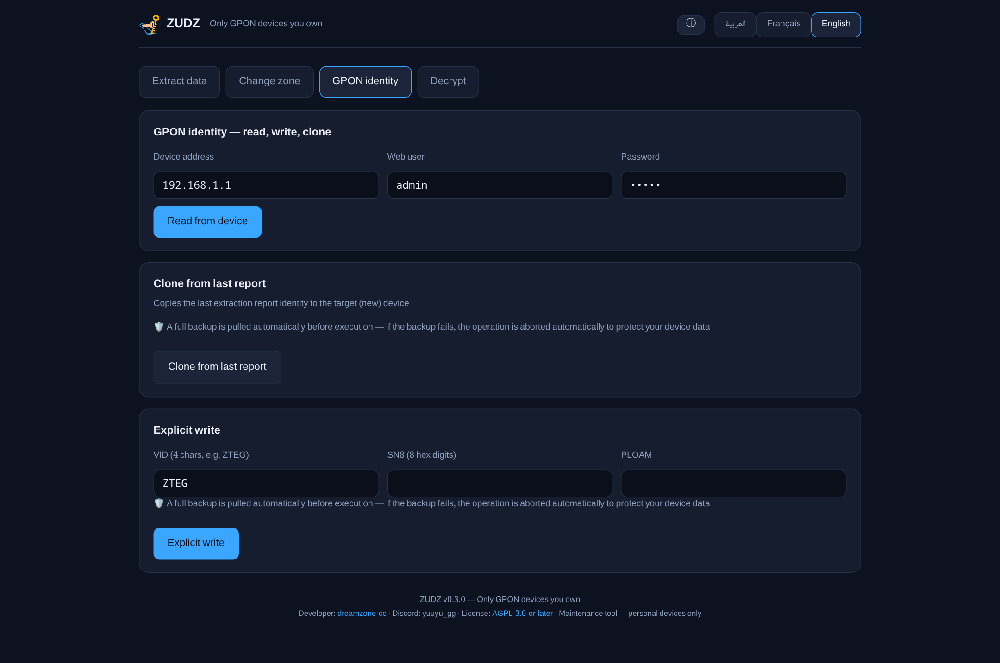
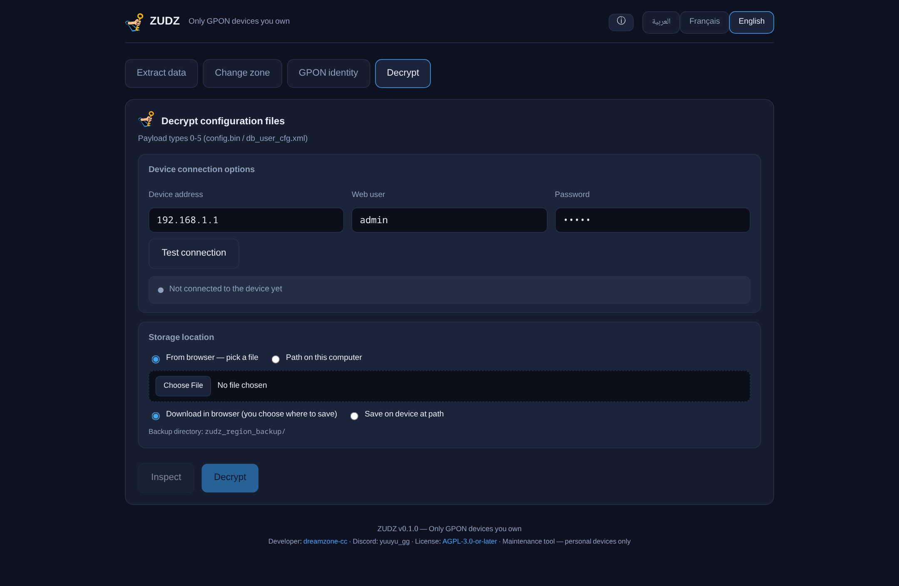

<div align="center">


# ZUDZ

**Z**TE **U**nlock, **D**ecrypt & **Z**one-changer

A maintenance tool for personal ZTE GPON/ONT devices — decrypt, extract & change region

[](LICENSE)

</div>

---

##  Screenshots

| Extract data | Change zone |
|:---:|:---:|
|  |  |

| GPON identity | Decrypt |
|:---:|:---:|
|  |  |

##  Legal notice — read first

> **This tool is intended for personal devices only** — devices you own or are explicitly authorized to manage.
> Using it on anyone else's equipment, to evade ISP billing, or to impersonate another device is prohibited.
> Any unlawful use is the user's sole responsibility — see [DISCLAIMER.md](DISCLAIMER.md).

---

##  Features

| Feature | Description |
|---|---|
|  **Diagnostic telnet unlock** | Factory-mode protocol (AES-192 key derivation from `server_rand`) to open telnet access on your device |
|  **Config decryption** | All ZTE encryption types (0–5): fixed pair, ZLIB, AES-128/256 with serial/MAC-derived keys |
|  **Credential recovery** | PPPoE / VoIP-SIP / WiFi / web accounts from your device's config or memory — for when you lose them |
|  **GPON identity** | Read / write / clone the serial and PLOAM password (TagParams via `setmac`) — the current identity is backed up automatically before any write |
|  **Region change** | `sdefconf` behind a safety gate: a full backup is pulled **automatically** before execution, and the operation aborts if the backup fails |
|  **GUI + CLI** | Local web UI in three languages (Arabic / French / English) plus a full command-line interface |

##  One-click launch

### Easiest way (Linux)

```bash
# One time only: grant execute permissions and install the menu icon
chmod +x run-zudz.sh install-desktop-entry.sh stop-zudz.sh
./install-desktop-entry.sh
```

After that, **search for ZUDZ in your applications menu and click it** — your browser opens on the UI directly.

You can also double-click `run-zudz.sh` (or use "Run as a program" in your file manager).

- On **first run** the launcher builds everything automatically (Rust core + web UI) — may take a few minutes.
- Afterwards it opens `http://127.0.0.1:8790` within seconds of the click.
- To stop: `stop-zudz.sh`.

### From the command line (optional)

```bash
./run-zudz.sh                      # full launch + open browser

# or manually:
cd zudz
cargo build --release                       # build the core
cd app && bun install && bun run build      # build the UI (one time)
cd .. && ./target/release/zudz-server 8790 app/build   # run
# UI: http://127.0.0.1:8790

./target/release/zudz --help                # full CLI reference
./target/release/zudz about                 # about / license notice
```

### Requirements

- [Rust](https://rustup.rs) (core) and [Bun](https://bun.sh) (UI) — needed on first run only
- Linux (tested on CachyOS/Arch); the UI runs in any modern browser
- **Telnet-based operations additionally require** the NIC MAC to be set to the diagnostic address `00:07:29:55:35:57` — the device filters port 23 on it. ZUDZ verifies this before unlocking and prints exact fix commands; see [docs/set-diagnostic-mac.md](docs/set-diagnostic-mac.md). Web scraping and config decryption do not need it.

##  Project layout

```
zudz/                    # Rust workspace (11 crates)
├── crates/zudz-crypto   # ZTE config decryption (types 0–5) + encrypasswd
├── crates/zudz-factory  # factory-mode telnet unlock protocol
├── crates/zudz-telnet   # ZTE-compatible telnet client
├── crates/zudz-gpon     # TagParams parsing & GPON identities
├── crates/zudz-db       # ZTE XML database parser
├── crates/zudz-web      # device LUA web scraping
├── crates/zudz-extract  # unified extraction (4 paths)
├── crates/zudz-region   # region change behind the safety gate
├── crates/zudz-meta     # project identity & license (single source)
├── crates/zudz-cli      # command-line interface
├── crates/zudz-server   # local 127.0.0.1 server + API + UI hosting
├── app/                 # SvelteKit UI (ar/fr/en)
└── tests/fixtures/      # synthetic vectors + public test samples
run-zudz.sh              # ← one-click launcher
install-desktop-entry.sh # ← install applications-menu icon
```

##  Privacy

- **Fully local server** — binds to `127.0.0.1` only; no connection to any external service.
- Reports the tool generates on your machine (credentials, identities) are written with `0600` permissions — **treat them as confidential and never share them**.
- This repository contains no real device data; all test vectors are fully synthetic.

##  Tests

```bash
cd zudz && cargo test --workspace
```

Differential tests match decryption output byte-for-byte against public reference samples.

##  Credits

- [zte-config-utility](https://github.com/mkst/zte-config-utility) (mkst, MIT) — decryption engine reference and public test samples
- The [hack-gpon](https://hack-gpon.org) community — region codes and ZTE protocol documentation

##  License

**GNU AGPL-3.0-or-later** — see [LICENSE](LICENSE). If you modify the tool and offer it as a network service, you must publish your modified source under the same license.

##  Developer

- GitHub: [dreamzone-cc](https://github.com/dreamzone-cc)
- Discord: `yuuyu_gg`

---

<div align="center">
<sub>Use responsibly — on your own devices only.</sub>
</div>
